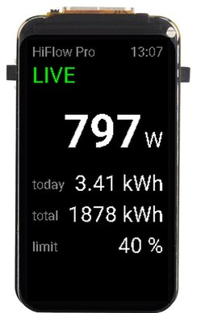
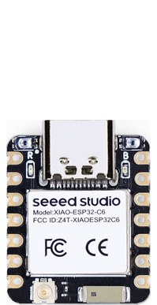
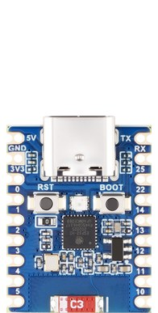
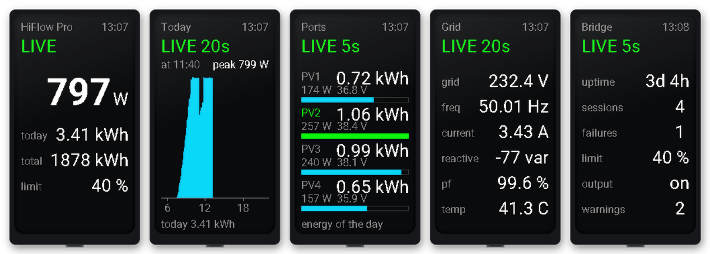

# HiFlow Pro to Zigbee bridge (ESP32-C6 / ESP32-H2)

ESPHome firmware that reads a **Hoymiles HiFlow Pro** inverter over **Bluetooth LE** and reports
it as a **Zigbee end device** to Home Assistant. No WiFi, no cloud.

```
inverter --BLE--> ESP32-C6/H2 --Zigbee--> coordinator --ZHA/Zigbee2MQTT--> Home Assistant
```

The protocol is a C port of [TheTiEr/hiflow-ble](https://github.com/TheTiEr/hiflow-ble).

## Status

Tested on one **HMS-2000-4WB** with all three boards below. Other HiFlow Pro / HMS-WB models that
work with [ha-hiflow-ble](https://github.com/TheTiEr/ha-hiflow-ble) should work too. Reports are
welcome.

## What you need

- One of the boards below
- A Zigbee coordinator in ZHA or Zigbee2MQTT (2.8.0 or newer)
- The inverter set up once with the S-Miles app, in BLE range of the board
- **No other BLE connection to the inverter**, e.g. the S-Miles app: it serves only one

### Boards

| | <br>ESP32-C6-LCD-1.47 | <br>XIAO ESP32-C6 | <br>ESP32-H2-Zero |
|---|:---:|:---:|:---:|
| Price (Amazon) | [~20 €](https://www.amazon.de/dp/B0DHTMYTCY) | [~18 €](https://www.amazon.de/dp/B0D2NKVB34) | [~10 €](https://www.amazon.de/dp/B0FR55G13T) |
| Chip | ESP32-C6, 512 KB RAM | ESP32-C6, 512 KB RAM | ESP32-H2, 320 KB RAM |
| Display | 1.47" 172x320 | none | none |
| Antenna | ceramic | ceramic or external (U.FL) | ceramic |
| Good | shows the values on the board | external antenna for a far coordinator | cheapest |
| Downsides | no external antenna | no display | slower full updates, no display, no external antenna |

## Quick start

1. **Install** with the [web flasher](https://jabla.github.io/esphome-hiflow-zigbee/): connect
   the board by USB, pick it, enter the Bluetooth PIN from the S-Miles app, press *Install*.

   Or with esptool: flash `hiflow-zb-<board>-<version>.factory.bin` from the latest
   [release](https://github.com/jabla/esphome-hiflow-zigbee/releases), then type `pin=<PIN>` in
   a serial terminal, such as pyserial's miniterm (comes with esptool,
   [all commands](components/hiflow_ble/README.md#settings-over-usb)). The board is
   *Espressif USB JTAG* in `ls /dev/serial/by-id/`.
   ```bash
   esptool --port /dev/ttyACM0 erase_flash
   esptool --port /dev/ttyACM0 write_flash 0x0 hiflow-zb-<board>-<version>.factory.bin
   python -m serial.tools.miniterm --echo /dev/ttyACM0 115200
   ```
2. **Pair.** Open pairing (ZHA: *Add device*, Zigbee2MQTT: *Permit join*), then put the board at
   the inverter on a USB charger. It joins as `HMS-2000-4WB Bridge` and takes the inverter after
   5 minutes. Status 6: ready. 16: several inverters, set the serial. 13: PIN missing or wrong.
3. **Updates:** add the release index (*Firmware updates over Zigbee (OTA)* below).
4. **Optional, ZHA: entity names.** ZHA names the entities by device class only. From a clone of
   this repo, this gives them the ids `sensor.inverter_zb_*` and English names:
   ```bash
   python3 -m venv .venv && .venv/bin/pip install websockets
   HASS_URL=http://homeassistant.local:8123 HASS_TOKEN=<long-lived token> \
     .venv/bin/python tools/ha_fix_bridge_entities.py
   ```
5. **Optional: energy dashboard.** It needs the template sensor in
   [`docs/ha-energy-template.yaml`](docs/ha-energy-template.yaml).

## Own build

With an own build you can:

- use another time zone (release images use CET with European summer time)
- fix the inverter values in the build
- keep the receiver always on
- set the C6-LCD's brightness, page time and night mode
- update from your own builds over Zigbee

See [`docs/own-build.md`](docs/own-build.md).

## Controls

- **Power limit** (endpoint 32): a slider in percent of the rated power. The inverter keeps it.
  0 % switches the output off.
- **On/off** (endpoint 34): the inverter's output. It shows what the bridge last set, because
  the inverter does not report it.

A change that cannot reach the inverter within two minutes (at night, for example) is dropped.

## Network time

The bridge takes the time from the Zigbee coordinator every 15 minutes. Without it, it takes the
inverter's time.

## Low power

By default the bridge is a sleepy Zigbee end device: the receiver is off between polls and the
chip light-sleeps. A command still arrives within a few seconds. On a computer's USB port the
chip stays awake. Details: [`components/zigbee_power/README.md`](components/zigbee_power/README.md).

## Display (ESP32-C6-LCD-1.47)

<p align="center"></p>

By day the panel shows the overview. The BOOT button steps through the other pages, 15 s each:

- **Today**: the power curve from 05:00 to 22:00 with the peak
- **Ports**: the energy of the day per PV input, with live power and voltage
- **Grid**: voltage, frequency, current, reactive power, power factor, temperature
- **Bridge**: uptime, BLE sessions, power limit, output, warnings

At night (no feed-in for five minutes) the panel goes dark and the LED glows dim red. A press
shows the pages. The day's values survive a reboot.

## Firmware updates over Zigbee (OTA)

After the first install, updates come over Zigbee. The bridge keeps running during the download.
An image that crashes or cannot reach the coordinator within 10 minutes rolls back by itself.

### From the releases

Each release has an `index.json` with full images and small deltas.

- **ZHA:** add it to `configuration.yaml` and restart Home Assistant:
  ```yaml
  zha:
    zigpy_config:
      ota:
        extra_providers:
          - type: z2m
            url: https://github.com/jabla/esphome-hiflow-zigbee/releases/latest/download/index.json
  ```
  ZHA checks the index once a day. A ZHA reload checks at once.
- **Zigbee2MQTT** shows no update entity for the bridge. Publish to
  `zigbee2mqtt/bridge/request/device/ota_update/update`:
  ```json
  {"id": "<device>", "url": "https://github.com/jabla/esphome-hiflow-zigbee/releases/latest/download/index.json"}
  ```

## More documentation

- [`docs/troubleshooting.md`](docs/troubleshooting.md): radio, inverter, Zigbee, USB
- [`components/hiflow_ble/README.md`](components/hiflow_ble/README.md): the component in another
  ESPHome config, configuration reference, settings over USB
- [`components/zigbee_power/README.md`](components/zigbee_power/README.md): the low-power mode
- [`components/zigbee_ota/README.md`](components/zigbee_ota/README.md): updates over Zigbee in
  detail
- [`docs/development.md`](docs/development.md): repository layout, tests, status codes

## Limitations

- After a boot, ZHA shows 0 until the first data arrives (about 30 s). The energy total stays
  correct.
- The power limit is in percent only, in 10 % steps. **Not meant for zero-export control.**
- No per-port error code. The warning count says how many warnings, not which.

## Contributing

Bug reports and pull requests are welcome. Layout, host tests
and tools: [`docs/development.md`](docs/development.md).

## Credits and license

MIT, see `LICENSE`. The protocol knowledge, the `.proto` files and the Python reference code in
`test/ref/` come from [TheTiEr/hiflow-ble](https://github.com/TheTiEr/hiflow-ble) (MIT).
[nanopb](https://github.com/nanopb/nanopb) is vendored under its zlib license. See
`THIRD_PARTY.md`.
